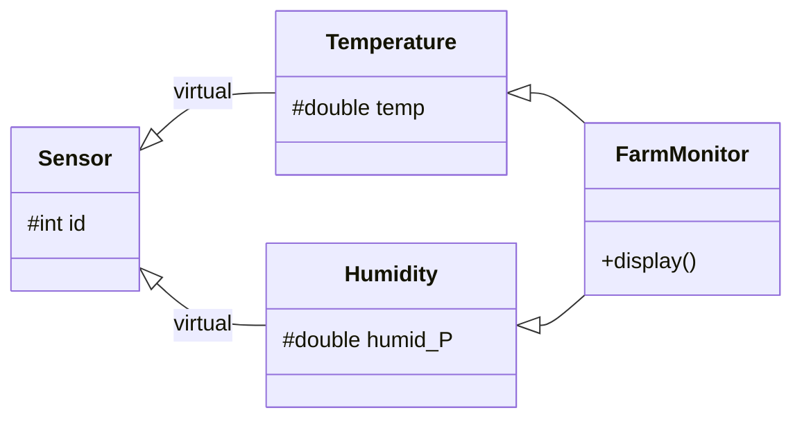

<div align="center">

# 🧩 Object-Oriented Programming Lab

### From C pointers to C++ polymorphism, one lab at a time


**Roushan Sharma** · Roll No. `B125103`

</div>

---

## 📖 About

This repository holds my solutions for the **Object-Oriented Programming Laboratory** course. Each lab covers one OOP idea, and most programs model a real-world situation: a railway ticket, a smart-home controller, a scholarship calculator, an e-wallet.

The labs start in **C**, with pointers, structs and `malloc`. They then move to **C++**: classes, dynamic memory, friend functions, function overloading, operator overloading, inheritance and runtime polymorphism.

> 📄 Each lab folder also contains the official **question-sheet PDF**, so you can read every problem statement next to its solution.

---

## 🗺️ Learning Roadmap

```mermaid
flowchart LR
    L1["🔹 Lab 1<br/>C Pointers & Structs"] --> L2["🔹 Lab 2<br/>Classes & Objects"]
    L2 --> L3["🔹 Lab 3<br/>Dynamic Memory"]
    L3 --> L4["🔹 Lab 4<br/>Friend Functions & Classes"]
    L4 --> T1["📝 Lab Test 1"]
    T1 --> L5["🔹 Lab 5<br/>Function Overloading"]
    L5 --> L6["🔹 Lab 6<br/>Operator Overloading"]
    L6 --> L7["🔹 Lab 7<br/>Inheritance"]
    L7 --> L8["🔹 Lab 8<br/>Runtime Polymorphism"]
```



---

## 📂 Repository Structure

```text
OOP LAB/
├── Lab 1/          → C fundamentals: pointers, arrays, structs, malloc
├── Lab2/           → Classes, objects, data hiding, member functions
├── Lab3/           → Dynamic memory with new / delete (Q1–Q10)
├── Lab4/           → Friend functions & friend classes (Q1–Q10)
├── Lab5/           → Function overloading (Q1–Q10)
├── LAB6/           → Operator overloading (Q1–Q10)
├── LAB7/           → Inheritance: single, multilevel, hierarchical, multiple, hybrid (Q1–Q5)
├── LAB8/           → Virtual functions & runtime polymorphism (Q1–Q5)
└── Test1_codes/    → Lab Test 1 (Set A & Set B) solutions (Q1–Q5)
```

From Lab 3 onwards, each question has its own `Qn/` folder with the `.cpp` source and a prebuilt Windows `.exe`.

---

## 🧪 Lab-by-Lab Breakdown

<details open>
<summary><h3>🔹 Lab 1: C Refresher (Pointers, Arrays & Structures)</h3></summary>

Revises the C basics that OOP builds on: pointer arithmetic, pass-by-address, structures and heap allocation.

| # | Program | What it does | Key concept |
|:-:|---|---|---|
| 1 | [`array_stat.c`](Lab%201/array_stat.c) | Finds the largest, smallest and average of an array | Arrays, `INT_MIN` / `INT_MAX` |
| 2 | [`rev_arr.c`](Lab%201/rev_arr.c) | Prints an array in reverse order | Array traversal |
| 3 | [`linearsearch.c`](Lab%201/linearsearch.c) | Searches an array for an element | Linear search |
| 4 | [`sum_pointer_arth.c`](Lab%201/sum_pointer_arth.c) | Sums elements using `*(ptr + i)` | Pointer arithmetic |
| 5 | [`swap_pointer.c`](Lab%201/swap_pointer.c) | Swaps two numbers through a function | Call by address |
| 6 | [`dynamic_mem.c`](Lab%201/dynamic_mem.c) | Reads and prints an array allocated on the heap | `malloc` / `free` |
| 7 | [`pointer_t_str.c`](Lab%201/pointer_t_str.c) | Fills a student record through a struct pointer | `->` operator |
| 8 | [`st_str.c`](Lab%201/st_str.c) | Reads and tabulates 5 student records | Array of structs |
| 9 | [`st_analysis.c`](Lab%201/st_analysis.c) | Finds the topper and the class average | Structs + functions |
| 10 | [`st_record_dynamic.c`](Lab%201/st_record_dynamic.c) | Finds the topper among *n* dynamically allocated students | Dynamic array of structs |

</details>

<details>
<summary><h3>🔹 Lab 2: Classes & Objects</h3></summary>

The first C++ classes: private data, public member functions, and splitting input, calculation and display into separate methods.

| # | Program | Real-world model | Highlights |
|:-:|---|---|---|
| 1 | [`square_calc.cpp`](Lab2/square_calc.cpp) | 📐 Square | Area & perimeter |
| 2 | [`temp_convert.cpp`](Lab2/temp_convert.cpp) | 🌡️ Temperature converter | Celsius → Fahrenheit |
| 3 | [`car_info.cpp`](Lab2/car_info.cpp) | 🚗 Car record | Data hiding |
| 4 | [`movie_ticket.cpp`](Lab2/movie_ticket.cpp) | 🎬 Movie booking | Cost calculation |
| 5 | [`hotel_room.cpp`](Lab2/hotel_room.cpp) | 🏨 Hotel room | Rent = days × daily cost |
| 6 | [`time_add.cpp`](Lab2/time_add.cpp) | ⏱️ Time | Objects as arguments and return values |
| 7 | [`cricket_score.cpp`](Lab2/cricket_score.cpp) | 🏏 Cricket player | Batting average + performance grade |
| 8 | [`hostel_fee.cpp`](Lab2/hostel_fee.cpp) | 🏠 Hostel fee | Late-fine logic |
| 9 | [`water_bill.cpp`](Lab2/water_bill.cpp) | 💧 Water bill | Slab billing (₹2 / ₹3 / ₹5 per litre) |
| 10 | [`mobile_recharge.cpp`](Lab2/mobile_recharge.cpp) | 📱 Mobile recharge | Menu-driven plan selection |

</details>

<details>
<summary><h3>🔹 Lab 3: Dynamic Memory Allocation in C++</h3></summary>

Uses `new` / `delete` for single values, arrays, objects, arrays of object pointers and 2-D matrices. Every program frees what it allocates and sets the pointer to `nullptr`.

| Q | Program | What it does | Allocation pattern |
|:-:|---|---|---|
| 1 | [`dyn_num_ops.cpp`](Lab3/Q1/dyn_num_ops.cpp) | Arithmetic on two heap integers | `new int` |
| 2 | [`dyn_arr_reverse.cpp`](Lab3/Q2/dyn_arr_reverse.cpp) | Reverses a dynamic array | `new int[n]` |
| 3 | [`cnt_ev_od_num.cpp`](Lab3/Q3/cnt_ev_od_num.cpp) | Counts even and odd numbers | `new int[n]` |
| 4 | [`dyn_search.cpp`](Lab3/Q4/dyn_search.cpp) | Searches a dynamic array | `new int[n]` |
| 5 | [`dyn_book_det.cpp`](Lab3/Q5/dyn_book_det.cpp) | Stores one book's details | `new Book` |
| 6 | [`dyn_prod_det.cpp`](Lab3/Q6/dyn_prod_det.cpp) | Bill & total inventory value for *n* products | `new Product*[n]` |
| 7 | [`dyn_char_arr.cpp`](Lab3/Q7/dyn_char_arr.cpp) | Counts vowels, consonants, digits and spaces | `new char[n+1]` |
| 8 | [`dyn_fn_process.cpp`](Lab3/Q8/dyn_fn_process.cpp) | Sum / min / max through helper functions | Pointer parameters |
| 9 | [`dyn_Emp.cpp`](Lab3/Q9/dyn_Emp.cpp) | Highest-paid employee & average salary | `new Employee*[n]` |
| 10 | [`dyn_matx.cpp`](Lab3/Q10/dyn_matx.cpp) | Adds two *m × n* matrices | `int**` 2-D allocation |

</details>

<details>
<summary><h3>🔹 Lab 4: Friend Functions & Friend Classes</h3></summary>

Gives selected outside functions or classes controlled access to `private` members, while the data stays encapsulated from everything else.

| Q | Program | Friend type | Scenario |
|:-:|---|---|---|
| 1 | [`personal_diart.cpp`](Lab4/Q1/personal_diart.cpp) | Function | 📔 Show a diary's last entry |
| 2 | [`mob_settings.cpp`](Lab4/Q2/mob_settings.cpp) | Function | 🔋 Low-battery warning |
| 3 | [`parking_slot.cpp`](Lab4/Q3/parking_slot.cpp) | Function | 🅿️ Parking slot occupancy |
| 4 | [`music_playlist.cpp`](Lab4/Q4/music_playlist.cpp) | Function (2 objects) | 🎵 Compare song durations |
| 5 | [`food_order.cpp`](Lab4/Q5/food_order.cpp) | Function | 🍛 Food order bill |
| 6 | [`smart_door.cpp`](Lab4/Q6/smart_door.cpp) | Class | 🚪 Security system checks door locks |
| 7 | [`game_ply_status.cpp`](Lab4/Q7/game_ply_status.cpp) | Class | 🎮 Game manager reports player status |
| 8 | [`train_seat_status.cpp`](Lab4/Q8/train_seat_status.cpp) | Class | 🚆 Ticket checker verifies seat booking |
| 9 | [`exam_result.cpp`](Lab4/Q9/exam_result.cpp) | Class | 📝 Percentage and pass/fail result |
| 10 | [`smart_device.cpp`](Lab4/Q10/smart_device.cpp) | Class | 🏡 Home controller turns devices ON/OFF |

</details>

<details>
<summary><h3>🔹 Lab 5: Function Overloading</h3></summary>

Compile-time polymorphism: one function name, different parameter lists (number, type, arrays and pointers).

| Q | Program | Overloaded function | Signatures covered |
|:-:|---|---|---|
| 1 | [`num_calc.cpp`](Lab5/Q1/num_calc.cpp) | `calculate()` | `(int,int)` · `(int,int,int)` · `(float,float)` |
| 2 | [`val_cmp.cpp`](Lab5/Q2/val_cmp.cpp) | `larger()` | 2 ints · 2 floats · 3 ints |
| 3 | [`arr_tot.cpp`](Lab5/Q3/arr_tot.cpp) | `total()` | int array · float array · first *n* elements |
| 4 | [`ele_search.cpp`](Lab5/Q4/ele_search.cpp) | `search()` | int array · char array · index range |
| 5 | [`modify_val.cpp`](Lab5/Q5/modify_val.cpp) | `modify()` | by value (int/float) · by pointer |
| 6 | [`dply_data.cpp`](Lab5/Q6/dply_data.cpp) | `display()` | int · float · char · int[] · char[] |
| 7 | [`cmp_data_set.cpp`](Lab5/Q7/cmp_data_set.cpp) | `compare()` | ints · floats · array equality |
| 8 | [`cnt_ops.cpp`](Lab5/Q8/cnt_ops.cpp) | `count()` | digits · array size · character occurrences |
| 9 | [`max_val_find.cpp`](Lab5/Q9/max_val_find.cpp) | `findMax()` | values · pointers · array |
| 10 | [`overloaded_data_processor.cpp`](Lab5/Q10/overloaded_data_processor.cpp) | `process()` | 5 overloads: mixed types, arrays, pointers |

</details>

<details>
<summary><h3>🔹 Lab 6: Operator Overloading</h3></summary>

Makes user-defined types work with built-in operators: binary, unary, relational, and prefix/postfix increment.

| Q | Program | Class | Operators overloaded |
|:-:|---|---|---|
| 1 | [`frac_cal.cpp`](LAB6/Q1/frac_cal.cpp) | `Fraction` | `+` `-` (auto-simplified with GCD) |
| 2 | [`time.cpp`](LAB6/Q2/time.cpp) | `Duration` | `+` `-` (normalises minutes) |
| 3 | [`book_price_rank.cpp`](LAB6/Q3/book_price_rank.cpp) | `Book` | `<` (by price, then by title) |
| 4 | [`unary_op.cpp`](LAB6/Q4/unary_op.cpp) | `AccountBalance` | unary `-` |
| 5 | [`score_track.cpp`](LAB6/Q5/score_track.cpp) | `Score` | prefix `++x` & postfix `x++` |
| 6 | [`date_checker.cpp`](LAB6/Q6/date_checker.cpp) | `Date` | `==` `!=` |
| 7 | [`inventory.cpp`](LAB6/Q7/inventory.cpp) | `InventoryItem` | `+` (only for matching items) |
| 8 | [`temp_comp.cpp`](LAB6/Q8/temp_comp.cpp) | `Temperature` | `>` `<` unary `-` |
| 9 | [`matrix_add.cpp`](LAB6/Q9/matrix_add.cpp) | `Matrix` (2×2) | `+` |
| 10 | [`shop_bill.cpp`](LAB6/Q10/shop_bill.cpp) | `Bill` | `+` `>` |

</details>

<details>
<summary><h3>🔹 Lab 7: Inheritance</h3></summary>

Reuses code through base and derived classes, `protected` members and constructor chaining. Covers all five inheritance types.

| Q | Program | Inheritance type | Hierarchy |
|:-:|---|---|---|
| 1 | [`railway_inh.cpp`](LAB7/Q1/railway_inh.cpp) | **Single** | `Ticket` → `RailwayTicket` (10% off above 300 km) |
| 2 | [`metadata.cpp`](LAB7/Q2/metadata.cpp) | **Multilevel** | `Image` → `CompressedImage` → `EncryptedImage` |
| 3 | [`exam_elig.cpp`](LAB7/Q3/exam_elig.cpp) | **Hierarchical** | `Candidate` → `RegularCandidate` / `ReappearCandidate` |
| 4 | [`uni_res.cpp`](LAB7/Q4/uni_res.cpp) | **Multiple** | `LibraryAccess` + `LaboratoryAccess` → `StudentAccess` |
| 5 | [`smart_agri.cpp`](LAB7/Q5/smart_agri.cpp) | **Hybrid (virtual)** | `Sensor` → `Temperature` / `Humidity` → `FarmMonitor` |



<sub>Q5 uses <b>virtual inheritance</b> to avoid the diamond problem, so <code>FarmMonitor</code> holds one shared <code>Sensor</code> base.</sub>

</details>

<details>
<summary><h3>🔹 Lab 8: Virtual Functions & Runtime Polymorphism</h3></summary>

A base-class pointer calls the derived class's `override` at runtime (dynamic dispatch).

| Q | Program | Base class | Derived classes | Behaviour chosen at runtime |
|:-:|---|---|---|---|
| 1 | [`doc_exp.cpp`](LAB8/Q1/doc_exp.cpp) | `Document` | PDF · Text · CSV | Export format |
| 2 | [`elec_bill.cpp`](LAB8/Q2/elec_bill.cpp) | `ElectricityPlan` | Residential · Commercial | Tariff calculation |
| 3 | [`auto_traffic_sig.cpp`](LAB8/Q3/auto_traffic_sig.cpp) | `TrafficSignal` | Urban · Highway | Green-light duration (capped) |
| 4 | [`data_back.cpp`](LAB8/Q4/data_back.cpp) | `BackupPolicy` | Full · Incremental | Storage requirement |
| 5 | [`scholar.cpp`](LAB8/Q5/scholar.cpp) | `Scholarship` | Merit · Need-based | Award amount |

```cpp
ElectricityPlan *ptr;
ptr = &residential;  ptr->calculateBill(150);   // → ResidentialPlan's version
ptr = &commercial;   ptr->calculateBill(150);   // → CommercialPlan's version
```

</details>

<details>
<summary><h3>📝 Lab Test 1</h3></summary>

Solutions to the first lab test (question papers: [Set A](Test1_codes/OOP_LAB_TEST_B1_SET_A.pdf) · [Set B](Test1_codes/OOP_LAB_TEST_B1_SET_B.pdf)). The test combines **dynamic memory**, **destructors**, **friends** and **overloading**.

| Q | Program | Scenario | Concepts tested |
|:-:|---|---|---|
| 1 | [`smart_locker_allocation.cpp`](Test1_codes/Q1/smart_locker_allocation.cpp) | 🔐 Smart lockers | Array of object pointers, destructor, `new string[]` |
| 2 | [`drone_batter_monitor.cpp`](Test1_codes/Q2/drone_batter_monitor.cpp) | 🚁 Drone battery | Friend function, heap objects |
| 3 | [`movie_queue.cpp`](Test1_codes/Q3/movie_queue.cpp) | 🎟️ Cinema queues | Friend swap of dynamic arrays, destructor |
| 4 | [`lab_intrument.cpp`](Test1_codes/Q4/lab_intrument.cpp) | 🔬 Lab instruments | Friend class that changes private data |
| 5 | [`e_wallet_record.cpp`](Test1_codes/Q5/e_wallet_record.cpp) | 💳 E-wallet | Overloaded `transaction()`, friend comparison |

</details>

---

## 🧠 Concepts Covered

<table>
<tr>
<td valign="top" width="50%">

**Foundations**
- ✅ Pointers & pointer arithmetic
- ✅ Structures & arrays of structures
- ✅ `malloc` / `free` and `new` / `delete`
- ✅ 2-D dynamic arrays (`int**`)
- ✅ Classes, objects & access specifiers
- ✅ Constructors, default arguments & initializer lists
- ✅ Destructors & cleaning up resources

</td>
<td valign="top" width="50%">

**OOP Pillars**
- ✅ Encapsulation & data hiding
- ✅ Friend functions & friend classes
- ✅ Function overloading (compile-time polymorphism)
- ✅ Operator overloading (unary, binary, relational, `++`)
- ✅ Single, multilevel, hierarchical, multiple & hybrid inheritance
- ✅ Virtual base classes (diamond problem)
- ✅ Virtual functions & `override` (runtime polymorphism)

</td>
</tr>
</table>

---

## ⚙️ Getting Started

### Prerequisites
- A C/C++ compiler: **GCC / MinGW-w64**, **Clang**, or **MSVC**
- *(Optional)* VS Code with the C/C++ extension or Code Runner

### Clone

```bash
git clone https://github.com/Roushan-2104/B125103.git
cd B125103
```

### Compile & run

```bash
# C programs (Lab 1)
gcc "Lab 1/array_stat.c" -o array_stat
./array_stat

# C++ programs (Labs 2–8, Test 1)
g++ -std=c++17 LAB8/Q2/elec_bill.cpp -o elec_bill
./elec_bill
```

> 💡 **Windows:** most question folders already contain a compiled `.exe`, so you can run it directly, e.g. `.\LAB6\Q1\frac_cal.exe`.

### Sample output: `LAB6/Q1/frac_cal.cpp`

```text
Addition: 5/6
Subtraction: 1/6
```

### Sample output: `LAB8/Q2/elec_bill.cpp`

```text
Residential Bill: Rs. 700
Commercial Bill: Rs. 1050
```

---

## 📊 At a Glance

| Lab | Topic | Programs | Language |
|:-:|---|:-:|:-:|
| 1 | Pointers, Structs, Dynamic Memory | 10 | C |
| 2 | Classes & Objects | 10 | C++ |
| 3 | Dynamic Memory (`new` / `delete`) | 10 | C++ |
| 4 | Friend Functions & Classes | 10 | C++ |
| 5 | Function Overloading | 10 | C++ |
| 6 | Operator Overloading | 10 | C++ |
| 7 | Inheritance | 5 | C++ |
| 8 | Runtime Polymorphism | 5 | C++ |
| T1 | Lab Test 1 | 5 | C++ |
| | **Total** | **75** | |

---

<div align="center">

### ⭐ If this repo helped you understand OOP, consider giving it a star!

Made with ☕ and `g++` by **Roushan Sharma**

</div>
